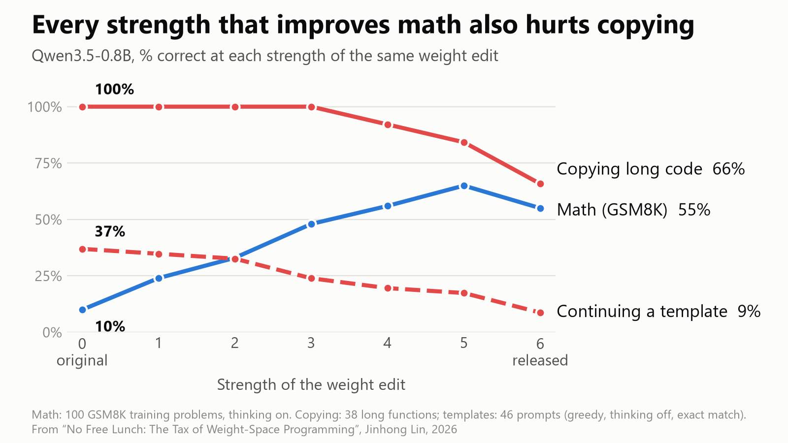

# No Free Lunch: The Tax of Weight-Space Programming

Code, prompts and results for the blog post *No Free Lunch: The Tax of Weight-Space Programming* (Jinhong Lin, 2026).

The post is a follow-up to [Sparks of Weight-Space Programming](https://rikiyat.github.io/blog/weight-space-programming/) (Takehi et al., 2026). In their Experiment 8, an LLM edited 131,072 weights of Qwen3.5-0.8B and fixed its reasoning loops. We measure what that edit costs outside math. Copying long code, continuing templates and repeating on request get worse. Across every strength of the edit we tested, the strengths that improve math also hurt copying.



## What is here

| Path | Contents |
| --- | --- |
| `code/` | All scripts: model download, edit verification, dose checkpoints, test suites, generation, scoring, figures |
| `data/` | The prompts of the three generation rounds (`round1_prompts.jsonl`, `round2_prompts.jsonl`, `round3_prompts.jsonl`) |
| `results/` | Outputs and scores of every experiment in the post |
| `figures/` | The two summary figures |

Model weights are not included. `code/download_models.py` fetches them, and `code/build_doses.py` rebuilds every dose.

## The edit and the doses

Only `mlp.down_proj` in layers 15 and 19 of the released model differs from the original: 64 columns per layer, 130,188 entries. Each layer's change is exactly rank one and follows `w' = w - c u (u^T w)` with `c = 6` (`code/verify_edit.py`, output in `results/verify_edit.txt`).

A dose `c` is `W_c = W + (c/6)(W_edited - W)` on those two matrices, computed in fp32 and cast back to bf16. `c = 0` is the original model, `c = 1` deletes the direction, and `c = 6` is bit-identical to the released weights.

## Results

| Dose c | 0 | 1 | 2 | 3 | 4 | 5 | 6 |
| --- | --- | --- | --- | --- | --- | --- | --- |
| Math, GSM8K train, 100 problems (% correct) | 10 | 24 | 33 | 48 | 56 | 65 | 55 |
| Copying long code, round 2, 38 prompts (% exact) | 100 | 100 | 100 | 100 | 92 | 84 | 66 |
| Copying long code, round 3, 50 prompts (% exact) | 98 | 98 | 98 | 96 | 92 | 82 | 64 |
| Continuing a template, round 2, 46 prompts (% exact) | 37 | 35 | 33 | 24 | 20 | 17 | 9 |
| Continuing a template, round 3, 48 prompts (% exact) | 42 | 33 | 31 | 27 | 23 | 19 | 10 |
| Copying JSON, round 3, 48 prompts (% exact) | 100 | 100 | 100 | 100 | 100 | 100 | 100 |

Full tables, including paired comparisons against `c = 0`, are in `results/*_scores.txt`.

## Setup

We ran everything on one RTX 5080 (16 GB) under WSL Ubuntu, in two Python environments.

- **transformers** (scoring and generation tests): Python 3.14, PyTorch 2.15.0 (CUDA 13.2), transformers 5.22.1, safetensors, numpy.
- **vLLM** (math experiment): Python 3.12 with vLLM 0.33.0, which brings its own PyTorch 2.14.0 (CUDA 13.0). Without a CUDA toolkit (`nvcc`), set `VLLM_USE_FLASHINFER_SAMPLER=0`.

```bash
# models: Qwen/Qwen3.5-0.8B @ 2fc06364715b967f1860aea9cf38778875588b17
#         RikiyaT/Qwen3.5-0.8B-weight-space-programming @ d1671a178705bcab7644806d23c535517f35723b
HF_HUB_DISABLE_XET=1 python code/download_models.py        # -> models/base, models/edited
python code/verify_edit.py                                  # rank-one check, c = 6
python code/build_doses.py models/doses 0,1,2,3,4,5,6       # one checkpoint folder per dose, for vLLM
```

## Reproducing the experiments

Run one GPU job at a time. In our setup, two concurrent jobs on the same GPU produced corrupted outputs.

**Copy-token log-probs (Tax 1).** Teacher-forced scoring of repeated random token sequences, Python standard-library source and license texts. The script reads `/usr/lib/python3.14` and `/usr/share/common-licenses` (Ubuntu); set `STDLIB_DIR` and `LICENSE_DIR` to point elsewhere.

```bash
python code/copytest.py --doses 0,1,2,3,4,5,6 --out results/copytest.json
```

**Generation round 1** (119 prompts, original vs released edit, greedy, thinking off):

```bash
python code/compare_gen.py data/round1_prompts.jsonl results/round1_generations.jsonl \
    --models base,edited --thinking off --decode greedy --max-new-tokens 3072 --batch-size 32
python code/score_copygen.py results/round1_generations.jsonl
```

**Generation rounds 2 and 3** (99 and 197 prompts, all doses):

```bash
python code/dose_gen.py data/round2_prompts.jsonl results/round2_generations.jsonl --doses 0,1,2,3,4,5,6 --batch-size 64
python code/score_dose.py results/round2_generations.jsonl
python code/dose_gen.py data/round3_prompts.jsonl results/round3_generations.jsonl --doses 0,1,2,3,4,5,6 --batch-size 64
python code/score_dose.py results/round3_generations.jsonl
```

**Math** (100 GSM8K training problems, thinking on, the original authors' sampling settings, 16,384-token limit; vLLM environment):

```bash
for c in 0 1 2 3 4 5 6; do
  python code/b_vllm.py models/doses/c$c $c results/math_gsm8k_16k.jsonl --n 100 --max-tokens 16384
done
python code/score_loop.py results/math_gsm8k_16k.jsonl
```

`code/loop_gen.py` runs the same math experiment with transformers; we used it as a cross-check (`results/math_hf_crosscheck.jsonl`).

The prompt suites can be regenerated from the Python 3.14 standard library with `code/build_copygen.py`, `code/build_dose_suite.py` and `code/build_code_suite.py`. The files in `data/` are the ones used in the post. Batched greedy decoding is not bit-identical across batch compositions or library versions, so small differences from our outputs are expected.

## Notes on the data

- In 6 of the 700 math outputs, the model wrote a few phrases in Chinese inside its reasoning. In this release those characters are replaced by `[CJK]`, and the rows carry `"cjk_redacted": true`. Scores were computed before the replacement and are unaffected.
- Generation prompts are built from functions and docstrings of the Python standard library, with identifiers renamed to made-up words. GSM8K problems are downloaded by the scripts and are not redistributed here.

## Licenses

The code is released under the MIT License. The prompts in `data/` derive from the Python standard library (Python Software Foundation License). The outputs in `results/` were produced by Qwen3.5-0.8B and the edited model, which are released under the Apache License 2.0.

## Citation

```bibtex
@misc{lin2026nofreelunch,
  title        = {No Free Lunch: The Tax of Weight-Space Programming},
  author       = {Lin, Jinhong},
  year         = {2026},
  month        = nov,
  howpublished = {Blog post},
  url          = {}
}
```
